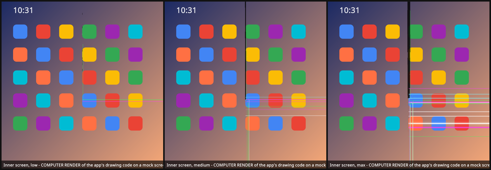
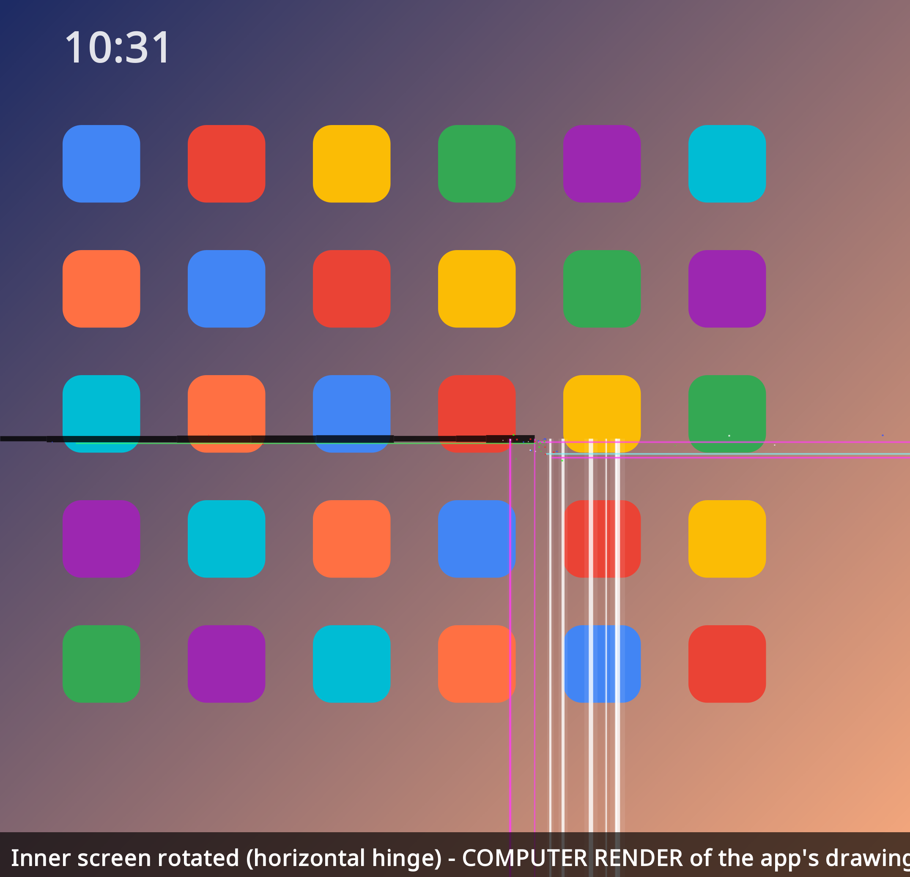
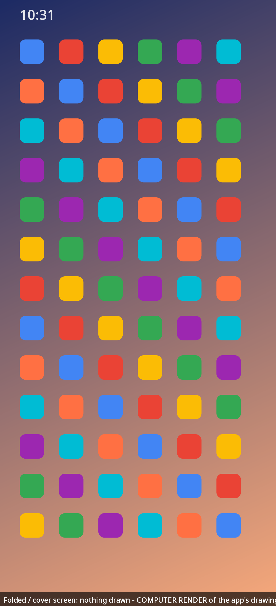

# iDuo 📱💥

**Give your Android foldable the authentic 2026 hinge experience.**

In October 2026, early owners of a certain brand-new $1,999 book-style foldable started posting photos of the
inner screen failing right at the hinge: a line of dead pixels running down the crease, then a "pop", then
bright stuck-on pixel rows shooting from the crease to the edge of the display. iDuo recreates that look on
**your** foldable: Pixel Fold, Pixel 9/10 Pro Fold, Galaxy Z Fold, OnePlus Open, and so on.

It's a joke. Nothing is broken. iDuo draws fake dead and stuck pixels on top of your screen, only while the
phone is **unfolded**, and every tap passes straight through. Fold the phone and the damage is gone. Unfold it
and the damage is back. One tap on **Stop** "repairs" the screen.



> These previews are **computer renders** of the app's own drawing code (`core/`) on a mock home screen.
> They're not phone screenshots.

## What it draws (pixel damage only)

It copies the reported failure. There's no fake glass and no cartoon cracks.

- ⬛ **A dead-pixel column down the crease**, from the top to the point where the panel "popped", 50–62% of
  the way down. At low severity it's a few dead dots. At high severity it's a wide, ragged dead band.
- 🌈 **Straight stuck-on pixel rows** in white, green, and magenta, running from the crease to the edge of
  the screen.
- ↓ **Vertical lines from the pop point down to the bottom**, next to the crease.
- ✨ **Stuck sub-pixels**: a cluster where the panel popped, plus a few strays along the crease.
- 🎚️ **Severity slider**, from *a few dead pixels* to *AppleCare territory* to *$999 inner screen* to
  *dead band*.
- **Flicker** and **dead-pixel line** toggles, plus **Regenerate** for a new random pattern.

## Only when unfolded

iDuo uses Jetpack WindowManager's `FoldingFeature`. It draws only when **all** of these are true:

- a hinge is reported, and it's `FLAT` or `HALF_OPENED`
- the hinge sits inside the overlay
- the screen is the big inner display (its shortest side is at least 560 dp)

On the cover screen, with no hinge reported, or on a regular phone, the service stays running but draws
nothing. The logic lives in `FoldGate` and is unit-tested (`./gradlew :core:test`).

| Rotated (horizontal hinge) | Folded / cover screen |
|---|---|
|  |  |

## Install

1. Download `iDuo.apk` from the [latest release](../../releases/latest).
2. Open it on your phone. If Android asks, allow installs from your browser or file manager ("Install unknown
   apps").
3. Open **iDuo** and tap **Grant "Display over other apps"**. In the settings screen that opens, turn iDuo
   **on**, then go back.
4. Allow notifications (Android 13+). That's how you get the Stop button.
5. Flip **Break my inner screen**, unfold the phone, and hand it to a friend. 😈

To stop it, tap **Stop** in the notification or turn off the switch in the app.

Requires a foldable on Android 11+ that reports a `FoldingFeature` (Pixel Fold / 9 Pro Fold / 10 Pro Fold,
Galaxy Z Fold, OnePlus Open, and similar). It installs on Android 10, but nothing is drawn there.

## Limitations

- On Android 12+ the system only lets touches pass through overlays that are at most 80% opaque, so the
  damage is drawn at 80% opacity.
- Updating the app stops a running overlay. Turn it back on in the app.
- Android doesn't let regular apps draw over some system surfaces, like the lock screen, parts of Settings,
  and the permission dialogs.
- If Android kills the app, the damage goes away. It does not restart itself.

## Build

```bash
./gradlew :app:assembleDebug          # debug APK
./gradlew :preview:run --args=docs    # re-render the preview PNGs
```

For a signed release, create `keystore.properties` in the project root (it's git-ignored):

```
storeFile=/path/to/your.jks
storePassword=...
keyAlias=...
keyPassword=...
```

Then run `./gradlew :app:assembleRelease`.

Project layout: `core/` is the pure-Kotlin damage generator, painter, and fold gate (shared by the app and the preview
renderer). `app/` is the Android app: overlay service, WindowManager hinge tracking, and UI. `preview/` is the
JVM/AWT renderer for the README images.

## Disclaimer

iDuo is a **parody / prank app**. It is not affiliated with, endorsed by, or connected to Apple Inc. "iPhone" is
a trademark of Apple Inc., used here only to describe what's being parodied. Please don't use it to scam
anyone into a repair, a return, or a warranty claim. Prank your friends and then show them the Stop button.

## License

[MIT](LICENSE) © 2026 blankspeaker
