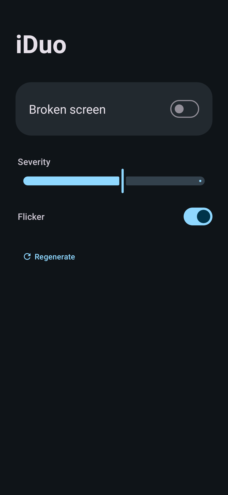

# iDuo 📱💥

**Give your Android foldable the authentic 2026 hinge-failure look.**

Right after launch in October 2026, owners of Apple's first foldable started posting photos of the inner
screen failing at the hinge. iDuo fakes that exact failure on **your** foldable (Pixel Fold / 9 Pro Fold /
10 Pro Fold, Galaxy Z Fold, OnePlus Open, …), and it only appears while the phone is **unfolded**.

It's a joke. Nothing is broken. iDuo draws pixels on top of the screen, touches go straight through, and
**Stop** in the notification makes it disappear.


> These previews are **computer renders** of the app's own drawing code (`core/`) on a mock home screen.
> They're not phone screenshots.

## What the real defect looks like

These are the published photos iDuo is based on. The photos aren't included in this repo:

- [Ars Technica](https://arstechnica.com/gadgets/2026/10/some-iphone-duo-screens-are-already-failing/): a lock screen with a solid cyan band.
- [BBC News](https://www.bbc.com/news/articles/c893zwlev2xpo): a home screen with a striped band.
- [iFixit teardown](https://www.ifixit.com/News/119895/iphone-duo-teardown): a Reddit photo from u/leftyhyzer16 showing a thin multicolour band.

All of them show the same failure, because the panel breaks where the hinge presses on it:

1. **A thin black dead line runs exactly on the crease**, from the top edge down to the failure point, about
   55–62% of the way down. There's a small dark knot right where it fails.
2. **From that point, one band of stuck-on pixel rows runs from the crease to the far edge.** It's all in the
   same rows: about 1–5% of the screen height. It's either a solid cyan block or crisp 1–3 px stripes, with
   pink/magenta at the top, white/cyan in the core, and green/lime at the bottom.
3. **A single lit lime / pale-yellow column hugs the crease** from the band down to the bottom edge.

There are no lines on the other half of the screen, no glass cracks, and no scattered noise.

## What iDuo draws

- **That exact pattern in whole device pixels**: integer rectangles with no anti-aliasing, at the colours from
  the photos.
- **Severity** sets how thick the band is (about 26 → 112 px on a 2152 px panel), how dense the stripes are
  (sparse thin stripes → a solid block), how wide the dead line and lit column are, and how long they run.
- **Flicker** makes stuck rows dim and brighten subtly.
- **Regenerate** gives you a new random variation.

## Only when unfolded

iDuo uses Jetpack WindowManager's `FoldingFeature`, which must be `FLAT` or `HALF_OPENED`. If the overlay gets
no hinge info, it falls back to the hinge-angle sensor (opened 60° or more means a centred crease). Either way,
it only draws on a big inner display whose shortest side is at least 560 dp.

On the cover screen, on a regular phone, or on a tablet with no hinge sensor, the service stays running but
draws nothing. The logic is unit-tested (`./gradlew :core:test`).

| App | Rotated (horizontal hinge) | Folded / cover screen |
|---|---|---|
|  |  |  |

## Install

1. Download `iDuo.apk` from the [latest release](../../releases/latest) and open it on your phone. Allow
   "Install unknown apps" if Android asks.
2. Open **iDuo**. If **Allow display over other apps** shows up, tap it and turn iDuo on.
3. Flip **Broken screen** on and allow the notification, which is where the Stop button lives.
4. Unfold the phone and hand it to a friend. 😈

It needs a foldable on Android 11 or newer.

## Limitations

- On Android 12+ the system only lets touches pass through overlays that are at most 80% opaque, so iDuo
  draws at 80% opacity.
- Android doesn't let regular apps draw over the lock screen or some system screens.
- Updating the app stops a running overlay. Turn it back on after updating.

## Build

```bash
./gradlew :core:test :app:testReleaseUnitTest   # unit tests + UI render test
./gradlew :app:assembleDebug
./gradlew :preview:run --args=docs              # re-render preview PNGs
```

For a signed release, create a git-ignored `keystore.properties` file:

```
storeFile=/path/to/your.jks
storePassword=...
keyAlias=...
keyPassword=...
```

Then run `./gradlew :app:assembleRelease`.

## Disclaimer

iDuo is a **parody / prank app**. It is not affiliated with, endorsed by, or connected to Apple Inc. "iPhone" is
a trademark of Apple Inc., used here only to describe what's being parodied. Please don't use it to scam
anyone into a repair, a return, or a warranty claim.

## License

[MIT](LICENSE) © 2026 blankspeaker
