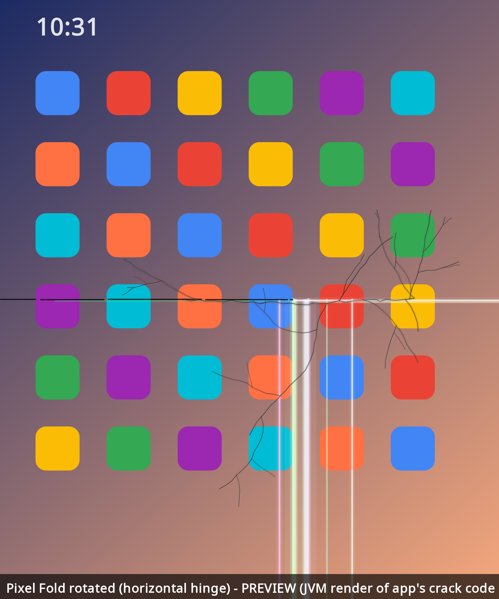
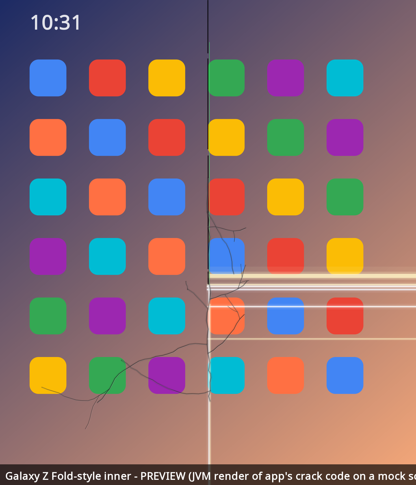
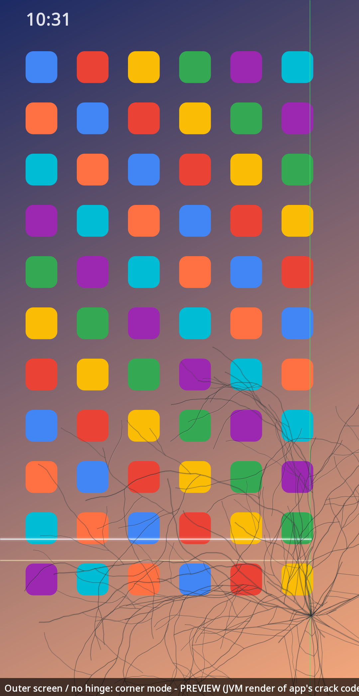

# iDuo 📱💥

**Give your Android foldable the authentic 2026 hinge experience.**

In October 2026, early owners of a certain brand-new $1,999 book-style foldable started posting photos of the
inner screen failing right at the hinge: a line of dead pixels running down the crease, then a "pop", then
bright stuck-on pixel rows shooting from the crease to the edge of the display. iDuo recreates that look on
**your** foldable: Pixel Fold, Pixel 9/10 Pro Fold, Galaxy Z Fold, OnePlus Open, and so on.

It's a joke. Nothing is broken. iDuo draws a picture on top of your screen, every tap passes straight through
it, and one tap on **Stop** makes it disappear.


> Previews are rendered on a desktop JVM from the **same crack-drawing code the app uses** (`core/`),
> laid over a mock home screen. They're not phone screenshots.

## Features

- 🔍 **Finds your hinge.** It uses Jetpack WindowManager (`FoldingFeature`) to locate the crease and lines
  the crack up on it, vertical or horizontal, and it moves the crack when you rotate, fold, or unfold.
- 🎲 **Procedural and different every time**, made of:
  - a dead-pixel column down the crease
  - a greenish "dead line"
  - bright OLED rows (with RGB fringing) running from the crease to the edge
  - a bright column below the impact
  - at higher severity, a real-looking glass fracture with branching hairlines and a spiderweb
- 🎚️ **Severity slider** that goes from *hairline* to *"it's just the crease"* to *AppleCare territory* to
  *$999 inner screen* to *shattered*.
- ✨ **Flicker** and **dead-pixel line** toggles, plus **Regenerate** for a fresh crack.
- 👆 **Your phone still works.** The overlay is `FLAG_NOT_TOUCHABLE | FLAG_NOT_FOCUSABLE`.
- 🔔 **A persistent notification with a Stop button**, so you can always "repair" the screen.
- 🙅 **No ads, no internet permission, and no data collection.**

| Pixel Fold rotated (horizontal hinge) | Galaxy Z Fold-style | Outer screen / no hinge (corner mode) |
|---|---|---|
|  |  |  |

## Install

1. Download `iDuo.apk` from the [latest release](../../releases/latest).
2. Open it on your phone. If Android asks, allow installs from your browser or file manager ("Install unknown
   apps").
3. Open **iDuo** and tap **Grant "Display over other apps"**. In the settings screen that opens, turn iDuo
   **on**, then go back.
4. Allow notifications (Android 13+). That's how you get the Stop button.
5. Unfold your phone, flip **Crack my screen**, and hand it to a friend. 😈

To stop it, tap **Stop** in the notification or turn off the switch in the app.

Requires Android 10 (API 29) or newer. Automatic hinge detection needs Android 11+ and a device that reports
a `FoldingFeature`.

## How the crack is placed

| Situation | What iDuo draws |
|---|---|
| Unfolded, hinge reported | Crack centred on the `FoldingFeature` bounds. Bright rows run toward the larger side. |
| Rotated | The hinge is re-read and the crack is rebuilt in the new orientation. |
| Inner screen, no hinge reported | It guesses a vertical crease at the screen centre. |
| Folded / outer screen / regular phone | A "dropped it" spiderweb in the lower corner. |

## Limitations

- On Android 12+ the system only lets touches pass through overlays that are at most 80% opaque, so the
  crack is drawn at 80%. It still looks right on a bright screen.
- Android doesn't let regular apps draw over some system surfaces, like the lock screen, parts of Settings,
  and the permission dialogs.
- If Android kills the app, the crack just goes away. It does not restart itself.

## Build

```bash
./gradlew :app:assembleDebug          # debug APK
./gradlew :preview:run --args=docs    # re-render the preview PNGs
```

For a signed release, create `keystore.properties` in the project root (it's git-ignored):

```
storeFile=/path/to/your.jks
storePassword=...
keyAlias=...
keyPassword=...
```

Then run `./gradlew :app:assembleRelease`.

Project layout: `core/` is the pure-Kotlin crack generator and painter (shared by the app and the preview
renderer). `app/` is the Android app: overlay service, WindowManager hinge tracking, and UI. `preview/` is the
JVM/AWT renderer for the README images.

## Disclaimer

iDuo is a **parody / prank app**. It is not affiliated with, endorsed by, or connected to Apple Inc. "iPhone" is
a trademark of Apple Inc., used here only to describe what's being parodied. Please don't use it to scam
anyone into a repair, a return, or a warranty claim. Prank your friends and then show them the Stop button.

## License

[MIT](LICENSE) © 2026 blankspeaker
